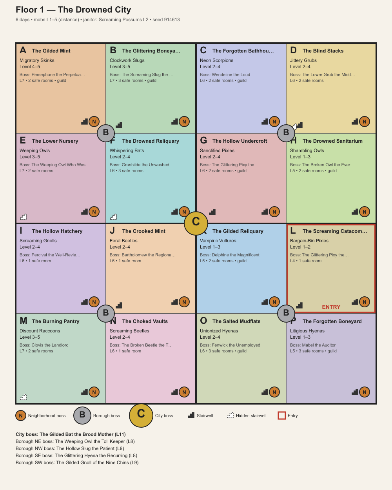
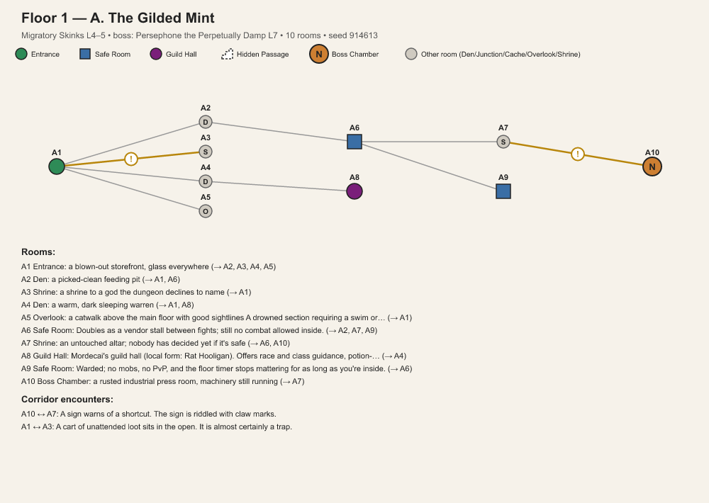
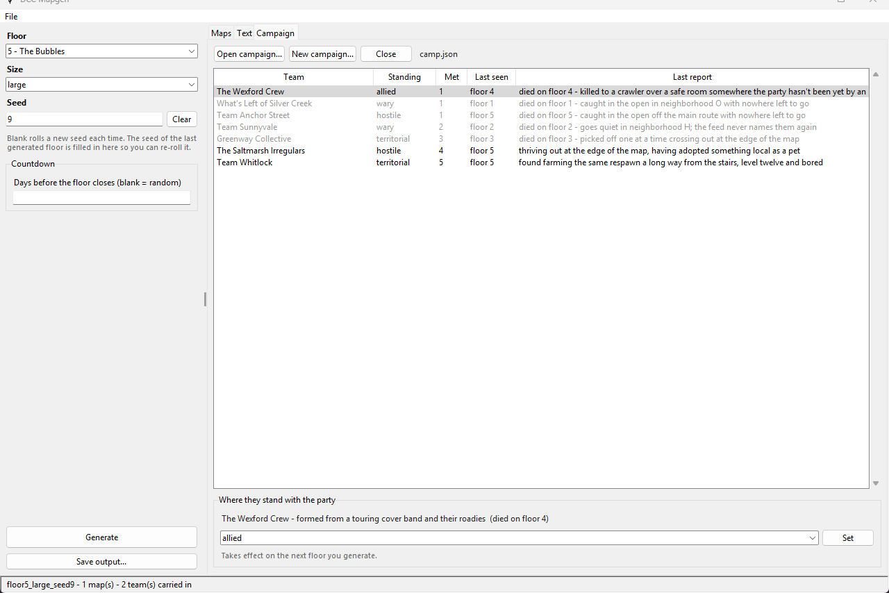

# DCC Mapgen

A procedural floor/map generator in the style of the *Dungeon Crawler Carl* book series (Matt Dinniman). Generates Markdown write-ups and SVG/PNG maps for Floors 1–6 and 8–11, with random (but seed-reproducible) neighborhoods, bosses, mobs, loot, quests, and — for Floors 1 and 2 — a full room-by-room layout for every neighborhood.

> **Unofficial fan project.** This tool is not affiliated with, endorsed by, or reviewed by Matt Dinniman, his publishers, or any other rights holders. It's a GM/worldbuilding aid built from publicly available fan-wiki lore, meant for personal tabletop/solo use.

## Features

- **Floors 1 & 2** — neighborhood/borough/city grid, from small up through large (1 City). Beyond that, huge/giant/massive/continent tile multiple Cities together — County (4 Cities), State (9), Country (16), Continent (25) — each City keeping its own City Boss, with one top-tier boss (County/State/Country/Continent) overseeing all of them. Bosses (with a word-bank uniqueness guard so names/forms don't collide), loot boxes, achievements, an Elite, other crawler teams, the tutorial guild, and a full connected **room graph** per neighborhood (safe rooms, hidden passages, guild hall, filler rooms, corridor encounters). `--stair-chance` and `--borough-boss-rate` tune how often neighborhood stairwells and borough bosses show up.
- **Floor 3** (The Over City) — settlements on a wilderness grid, roaming bosses, locked stairwells, quests, one Elite.
- **Floor 4** (The Iron Tangle) — schematic rail/transit map.
- **Floor 5** (The Bubbles) — four quadrants, castles, factions.
- **Floor 6** (The Hunting Grounds) — Floor 3's grid reskinned as jungle, with hunter parties and a bounty board.
- **Floor 8** (Ghosts of Earth) — polar folklore map with totem cards and a deckmaster ladder.
- **Floor 9** (Faction Wars) — the nine-slice pie around Larracos, warlords, stance paths.
- **Floor 10** (Don't Come In Last) — seven-heat race season, garage/vehicle/upgrades.
- **Floor 11** (A Parade of Horribles) — parade route, judges, arena boss.
- **Campaigns** — other crawler teams carry from floor to floor, keeping who they are and where they stand with the party, until their luck runs out. See [Campaigns](#campaigns).
- A **desktop app** (`dcc_mapgen_gui.py`) wrapping all of the above: pick a floor and size, generate, and read the write-up and browse every map without leaving the window. See [Desktop app](#desktop-app).
- Every floor supports `--seed` for reproducible maps — byte-for-byte, and [tested](#tests) as such — and `--image`/`--save` for SVG or PNG output (PNG needs the optional `resvg-py` package).
- `--rooms-for` can (re)generate just the room-level detail for one neighborhood from a floor you already generated and are playing, without touching the rest of the data.

Word banks (names, mobs, bosses, loot, room flavor, etc.) live in `data/*.json` — edit those to add or reskin content without touching the code.

Mob vocabulary is shared rather than kept per floor. `data/common.json` holds `MOB_NOUN`
and `MOB_ADJ` grouped by where a word can show up — `anywhere`, `urban`, `rail`,
`jungle` — and `FLOOR_MOB_TAGS` says which of those each floor draws from, and how
heavily:

```json
"FLOOR_MOB_TAGS": { "4": { "anywhere": 2, "rail": 3 } }
```

The tag is picked first by weight, then a word from it, so the Iron Tangle leads with
porters and signalmen but still turns up the occasional Hazard-Pay Shark. To add a mob,
drop it under the tag it belongs to; to give a floor a new habitat, add the tag to both
banks and list it for that floor.

`BOSS_MECHANICS` is split the same way, into `any` and `grand`. Neighborhood bosses
draw only from `any`; borough, city and top-tier bosses take one `grand` mechanic —
the arena-scale ones that reshape a room — plus one ordinary one. A floor deals them
from a shuffled deck, so it runs through every mechanic before repeating any, and a
boss run is not the same fight over and over.

## Examples

| Main map | Room detail (per neighborhood) |
|---|---|
|  |  |

(`sample/floor1_large_seed914613.md` in this repo is a full sample write-up for a large dungeon if you want to see the Markdown output.)

## Installation

### Option A: run from source (any OS)

Requires Python 3.9+.

```
git clone https://github.com/MumblesCrzy/DCC_Mapgen.git
cd DCC_Mapgen
pip install -r requirements.txt   # optional, only needed for PNG output
python dcc_mapgen.py --floor 1 --size medium
python dcc_mapgen_gui.py          # ...or the desktop app
```

### Option B: standalone executable (Windows or Linux)

Check the [Releases](../../releases) page for bundled builds — no Python install required. Each platform ships two: `dcc_mapgen` (the command line) and `dcc_mapgen_gui` (the [desktop app](#desktop-app)). All are built automatically from this repo via GitHub Actions.

On Linux the desktop app needs your distribution's Tk package if it isn't already present (`sudo apt install python3-tk` on Debian/Ubuntu); the command-line build needs nothing.

## Desktop app

```
python dcc_mapgen_gui.py
```


Floor, size and seed are always on the left; the options below them swap to match the
floor you picked, so you only ever see settings that affect the map in front of you.
**Generate** fills the *Maps* tab and the *Text* tab, and **Save output...** writes the
same `floorN_size_seedS.md` plus map files that `--save` produces on the command line.

- The map dropdown lists every map the floor produces — the overview plus one room map
  per neighborhood on floors 1–2, or the seven heats on floor 10.
- **Fit**, **1:1** and **+**/**−** zoom; each step re-renders from the SVG rather than
  scaling pixels, so text stays sharp however far you zoom in. Drag to pan, scroll to
  scroll, ctrl+scroll to zoom.
- The seed box is filled in with the seed that was used, so a map you like can be
  re-rolled or tweaked without hunting for it.
- **File → Re-roll rooms from a saved floor** is `--rooms-for` in the GUI: point it at a
  floor 1–2 Markdown file this app wrote and re-roll one neighborhood's rooms.
- The **Campaign** tab carries crawler teams between floors and is where you change
  where a team stands with the party. See [Campaigns](#campaigns).

The inline preview uses `resvg-py` (`pip install -r requirements.txt`). Without it the app
still generates and saves everything — maps just save as SVG, and **Open in browser**
shows the map instead of the built-in preview.

`python dcc_mapgen_gui.py --self-test` (or `python gui_smoke_test.py`) drives the app
through a generate and checks the write-up, the map list and the rendered preview all
arrive — this is what CI runs against the packaged builds.

## Campaigns

Every floor reports the other crawler teams sharing it. A campaign follows those
teams from floor to floor, so the group the party traded with on Floor 1 is still
out there on Floor 6 — or died on Floor 4 and is remembered for it.

```
python dcc_mapgen.py --floor 1 --size medium --campaign mycrawl.json
python dcc_mapgen.py --floor 2 --size medium --campaign mycrawl.json
```

The file is created on first use, so the same flag starts a campaign and continues
one. Every team still alive comes onto the next floor keeping its name, who they
were before the Collapse, and where it stands with the party; only its fate is
dealt again. A team whose fate comes up fatal leaves the floor but stays on the
roster, with the floor it died on.

The party also meets new groups on every floor, not only when deaths have left
room — 8.1 million crawlers enter Floor 1 and no party can know a fraction of them.
So a roster turns over rather than dwindling: it settles at about four teams on a
medium floor and eight on a large one, whatever the dice do.

Teams that have already lived through a floor or two are harder to kill than ones
the party has just met — around three times harder, once a team is four floors in.
Harder, not safe: a veteran still dies, and roughly half of full Floor 1-to-11 runs
end with one of the original groups still out there.

Standing is the part the party changes in play. Befriend the group that attacked
them on Floor 2, or fall out with an ally:

```
python dcc_mapgen.py --floor 3 --campaign mycrawl.json --standing "Thistle=allied"
```

A unique partial name is enough. The five standings that come with reaction text are
`hostile`, `territorial`, `wary`, `friendly` and `allied`, but any wording is
accepted — a table that decides a group is "owed a favour" can write that.

In the desktop app this is the **Campaign** tab: open or start a roster, and every
floor generated afterwards carries it. The table lists everyone met so far, the dead
greyed out with the floor that killed them, and standing is editable there.



Carrying a campaign never changes the floor itself. Teams are dealt from their own
random stream, so the same seed gives the same map and the same everything else
whether or not a campaign is open.

## Usage

### One example per floor

```
python dcc_mapgen.py --floor 1  --size medium --seed 42                                    # The Collapse: neighborhoods/boroughs/city, full room graphs
python dcc_mapgen.py --floor 2  --size large  --seed 42                                    # Same shape as Floor 1, tougher mob band, bosses roam
python dcc_mapgen.py --floor 3  --size medium --seed 42                                    # The Over City: settlements, quests, roaming bosses
python dcc_mapgen.py --floor 4  --size large  --seed 42                                    # The Iron Tangle: schematic rail/transit map
python dcc_mapgen.py --floor 5  --size medium --seed 42                                    # The Bubbles: four quadrants, castles, factions
python dcc_mapgen.py --floor 6  --size large  --seed 42                                    # The Hunting Grounds: jungle, hunter parties, bounty board
python dcc_mapgen.py --floor 8  --size medium --region "East Asia" --seed 42               # Ghosts of Earth: folklore polar map, totem cards
python dcc_mapgen.py --floor 9  --size large  --warlords generated --wildcard --seed 42    # Faction Wars: nine-slice pie around Larracos
python dcc_mapgen.py --floor 10 --size medium --vehicle biological --party 3 --seed 42     # Don't Come In Last: seven-heat race season
python dcc_mapgen.py --floor 11 --size large  --seed 42                                    # A Parade of Horribles: route, judges, arena boss
```

(Floor 7 doesn't exist, per canon.)

### More options

```
python dcc_mapgen.py --floor 1 --size small --days 5 --out floor1.md
python dcc_mapgen.py --floor 2 --size large --seed 9 --out f2.md --image f2.svg
python dcc_mapgen.py --floor 2 --size large --save maps/     # writes maps/floor2_large_seedNNN.md + .png + room maps
python dcc_mapgen.py --floor 1 --size massive --seed 1        # Country: 16 Cities, 1 Country Boss
python dcc_mapgen.py --floor 1 --size continent --seed 1       # Continent: 25 Cities, 1 Continent Boss
python dcc_mapgen.py --floor 1 --size large --stair-chance 0.5 --borough-boss-rate 0.5

# Add room-level detail to a neighborhood you already generated and are playing:
python dcc_mapgen.py --rooms-for my_floor1.md --rooms-for-label C --seed 42 --image roomC.png
```

Run `python dcc_mapgen.py --help` for the full flag list (per-floor options like `--region`, `--warlords`, `--vehicle`, `--party`, etc.).

## Tests

```
python -m unittest discover -s tests -v
```

Stdlib `unittest`, so nothing needs installing, and it finishes in a few seconds.
GitHub Actions runs it on every push across Linux and Windows.

`tests/golden.json` pins a hash of the Markdown and maps for every floor at every
size, plus the multi-city tiers and each floor's own options. Two things are checked:

- **Output hasn't drifted.** Any change to what the generator emits fails the golden
  test. When the change is intended, `python tests/update_golden.py` refreshes the
  hashes and prints which cases moved — commit that diff with the change, and it
  doubles as a record of what the change actually affected.
- **Seeds are genuinely reproducible.** The corpus is regenerated in separate
  interpreters under a spread of `PYTHONHASHSEED` values. Python salts string
  hashes per process, so anything that lets the iteration order of a set or dict
  reach the output produces a different map each run — the same seed, a different
  dungeon. Three such bugs had shipped in this project (corridor encounters, the
  Floor 9 stairwell angles, and the Floor 4 transfer connectors); within a single
  process all three were invisible, because that order is stable until the
  interpreter restarts.

A third group covers the floor 1–2 crawler roster, which is dealt rather than rolled
so a floor gets a spread of fates and dispositions: no roster repeats a name, origin
or status; a floor of more than one team is never all fatalities; the dispositions
span the hostile–allied scale; and a name like "What's Left of X" only lands on a
team that actually lost something.

If you add a floor, the suite fails until `tests/corpus.py` covers it.

## License

GPL-3.0 — see [LICENSE](LICENSE). The code is free to use, modify, and redistribute under those terms; the *Dungeon Crawler Carl* setting, names, and lore referenced by the word banks belong to their respective rights holders.
